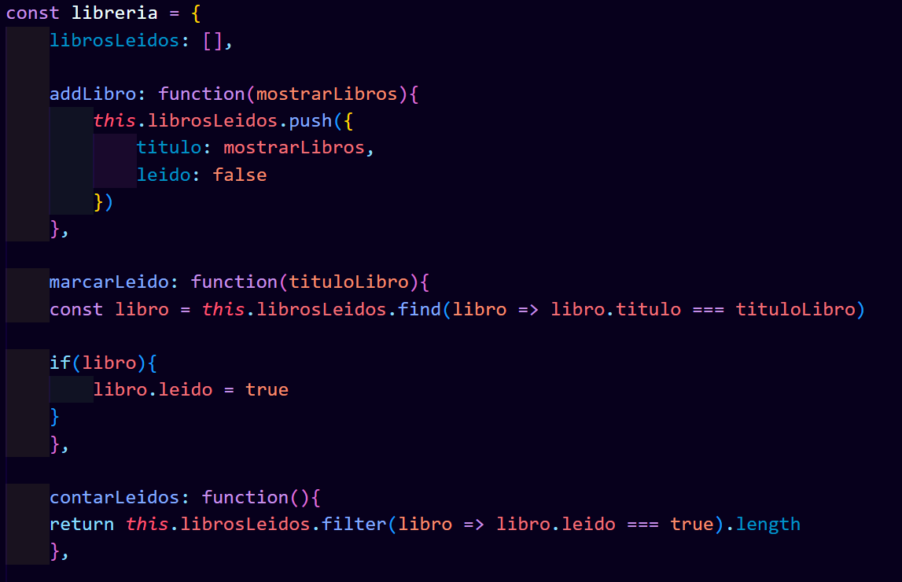
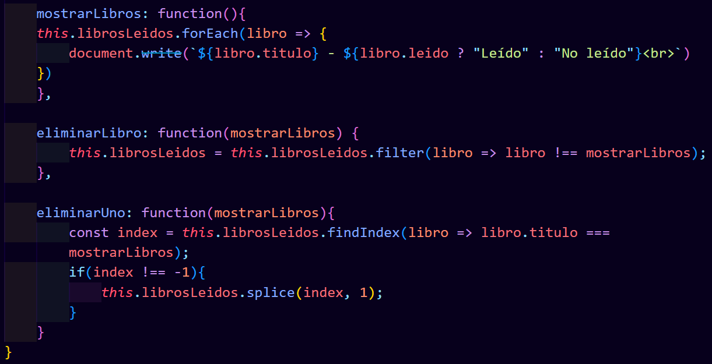
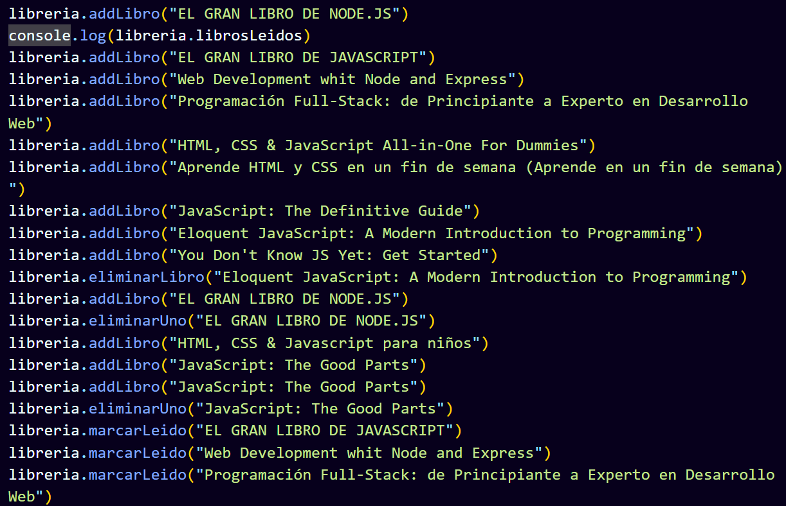
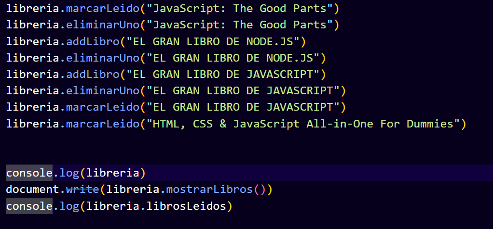
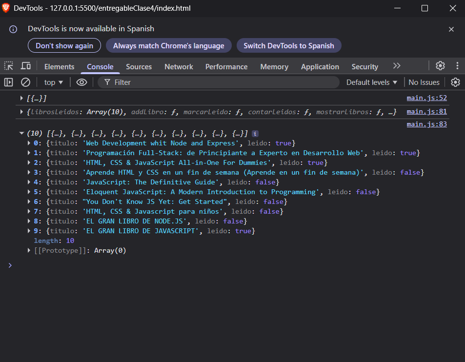
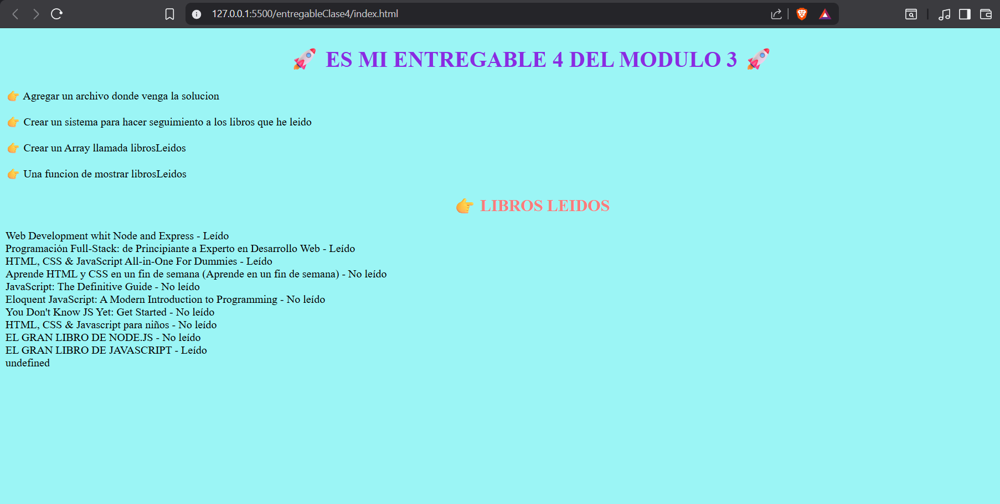

# AQUI ESTA MI SOLUCIÓN AL RETO 4 DEL MODULO 3

### Cree una variable denominada libreria
### Cree un Array llamado librosLeidos vacio para que se guarden todos los libros, con una función llamada mostrarLibros
### Cree addLibro para poder ir agregando libros y con .push para que los valla agregando al último
### Cree un function para que me vaya contando los libros y otra donde me muestre los libros leidos y no leidos mediante true o false
### Cree 2 funciones para eliminar una que elimine todo el libro y otra a donde solo elimine la primer coincidencia

# AGREGANDO LIBROS

# ELIMINANDO LIBROS

# MOSTRANDO EN CONSOLA RESULTADO

# MOSTRANDO RESULTADO EN LA WEB
